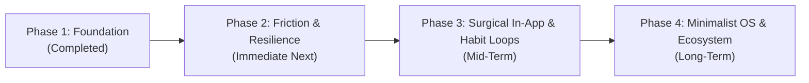

# 🚀 GetBackToWork: Strategic Product Roadmap

A comprehensive product roadmap positioning **GetBackToWork** as the premier, zero-compromise, open-source replacement for **Regain**, **Opal**, and **Freedom**. 

Designed around **100% local privacy**, **psychological friction (not panic)**, **surgical granular blocking**, and **zero paywalls on core focus mechanics**.

---

## 🧭 Strategic Pillars & Regain Competitive Analysis

| Dimension | Regain / Competitors | GetBackToWork Strategy |
| :--- | :--- | :--- |
| **Privacy & Cloud** | Requires cloud account; sends telemetry & screen time data to remote servers. | **100% Offline & Local**: Zero accounts, zero analytics, open-source verifiable privacy. |
| **Strict Lockout** | Rigid "Cold Turkey" lockouts that lead users to panic, force-close, or uninstall. | **Emergency Pass with Friction**: 60-second breathing cooldown or 50-word written intention. |
| **Monetization** | Core blocking features, schedules, and themes locked behind subscription paywalls. | **Zero Paywalls on Core Blocking**: 100% free blocking forever; optional tips/cosmetics only. |
| **Habit Interception** | Static block screens; easy to habituate or ignore. | **Earn Your Scroll**: Physical movement (squats/pushups) or micro-puzzles to earn 10 min. |
| **Granular In-App** | Binary app blocking; blocks the entire app or crude overlays. | **Surgical In-App Node Blocking**: Kills Reels/Explore & YT Home while keeping Search & DMs. |
| **Visual Design** | Stimulating, high-contrast bright interfaces. | **Low-Contrast Calming Dark Mode**: Deep slate/charcoal palette designed to lower dopamine. |

---

## 🗺️ Roadmap Execution Phases

### Phase 1: Core Foundation & Stability (✅ Completed)
- [x] **Foreground Focus Timer Service**: Battery-efficient Android 14 `FOREGROUND_SERVICE_SPECIAL_USE` timer with wake lock.
- [x] **Real-Time App Blocker**: Accessibility Service window transition blocker with anti-flicker grace periods.
- [x] **Dynamic Whitelist with Real Icons**: Instant memory querying of installed packages with high-resolution app icon bitmaps.
- [x] **Saved Groups / Profiles**: Reusable profile switcher (`Calls Only`, `Work Essentials`, user custom profiles) directly accessible from the main dashboard.
- [x] **Anti-Uninstall Settings Guard**: Mid-session interception of Android Settings to prevent tampering or deleting the app.
- [x] **Permanent Adult Content Filter**: OS-level zero-bypass Cloudflare 1.1.1.1 for Families DNS integration.

---

### Phase 2: Friction, Anti-Panic & Motivational Experience (🎯 Immediate Next)

#### 1. The Anti-"Cold Turkey" Emergency Pass
- **60-Second Cooling-Off Cooldown**:
  - Instead of a hard wall, users can request an Emergency Pass.
  - Displays a calm, breathing circular animation counting down 60 seconds.
  - If the user leaves the screen before 60 seconds elapses, the pass is canceled.
- **50-Word Intention Gate**:
  - Alternative emergency unlock: requires typing at least 50 words explaining: *"Why do I genuinely need to open this app right now?"*
  - Automatically logged to a local "Reflections Journal" stored on device.
- **Emergency Pass Limits**:
  - Configurable: 1 to 2 passes max per 24 hours.

#### 2. Custom Motivational & Life-Goal Overlays
- **Days Left in the Year Counter**:
  - Live percentage progress bar of the current year (e.g., *"Only 47 days left in 2026. Is scrolling worth it?"*).
- **Personal Written Goals**:
  - Display the user's top 3 self-defined lifetime or career goals directly on the block screen.
- **Custom Audio & Visual Reminders**:
  - Option to display a personal family photo or play a short custom audio clip on block.

#### 3. Calming, Low-Contrast Dark Mode (✅ Completed)
- Palette transitioned to deep charcoal (`#13151A`), muted slate surfaces (`#1B1E26`), grounding warm terracotta clay (`#C78465`), peaceful sage (`#7FA292`), and glare-free soft linen typography (`#E3E5EB`).
- Flattened navigation bar elevation and eliminated harsh white borders.

---

### Phase 3: "Earn Your Scroll" & Granular Feed Blocker (📅 Mid-Term)

#### 1. Physical & Mental "Earn Your Scroll"
- **Accelerometer-Based Movement Tracking**:
  - Require 10 pushups or 15 bodyweight squats to unlock a strict 10-minute scroll timer.
  - Uses device accelerometer and gyro sensor data locally (zero camera feeds transmitted).
- **Camera Pose Detection (Optional)**:
  - Local Google ML Kit pose detection to count physical repetitions.
- **Mental Clarity Puzzles**:
  - Rapid arithmetic or tactical chess puzzles (mate-in-1 / mate-in-2) to break autopilot brain fog.

#### 2. Granular In-App Feed Blocking
- **YouTube Surgical Blocker**:
  - Intercepts `com.google.android.youtube` navigation:
  - Hides/Blocks **Home Feed** (`accessibilityNodeId` / text matching "Home").
  - Hides/Blocks **Shorts Tab** (`"Shorts"`).
  - Preserves **Subscriptions**, **Library**, and the **Search Bar**.
- **Instagram Surgical Blocker**:
  - Blocks the **Reels** tab and **Explore Grid** while keeping **Direct Messages** and Profile accessible.
- **LinkedIn & X (Twitter) Feed Cleaners**:
  - Hides the algorithmic *"For You"* tab and infinite scroll home feeds.

---

### Phase 4: Minimalist OS, Widgets & Ecosystem (🚀 Long-Term)

#### 1. Built-In Minimalist Launcher Mode
- **Text-Only Home Screen Replacement**:
  - Built-in minimal launcher mode toggled during active focus hours.
  - Strips all colorful app icons; replaces them with a clean, alphabetical text list.
  - Eliminates visual triggers on the Android home screen.

#### 2. Glanceable Android Home Screen Widgets
- **Daily Focus Dial Widget** (`AppWidgetProvider`):
  - Displays remaining daily focus goal and current streak.
  - 1-tap "Deep Focus" widget button to start an instant 25-minute Pomodoro without opening the full app.

#### 3. 100% Local Privacy & Open-Source Verification
- **Zero Cloud Infrastructure**:
  - All SQLite / Room databases and SharedPreferences remain strictly local to the device filesystem.
  - No network permissions required for core app binaries.
- **Reproducible Open-Source Builds**:
  - Public repository build scripts allowing security-conscious users to verify that screen data and package queries never leave the device.

---

## 📊 Feature Prioritization Matrix

| Feature | User Impact | Implementation Complexity | Target Release |
| :--- | :--- | :--- | :--- |
| **Emergency Pass (60s Cooldown / Intention Prompt)** | 🟢 Very High | 🟡 Medium | **v1.2** |
| **Custom Motivational & Year Countdown Overlays** | 🟢 Very High | 🟢 Low | **v1.2** |
| **Low-Contrast Eye-Friendly Dark Mode Refresh** | 🟡 Medium | 🟢 Low | **v1.2** |
| **Granular YouTube Shorts & Insta Reels Blocker** | 🟢 Very High | 🔴 High | **v1.3** |
| **Home Screen Focus Widgets (Glanceable Stats)** | 🟡 Medium | 🟡 Medium | **v1.3** |
| **"Earn Your Scroll" Movement & Puzzle Challenges** | 🟢 Very High | 🔴 High | **v1.4** |
| **Built-In Minimalist Text Launcher Mode** | 🟡 Medium | 🔴 High | **v1.5** |
